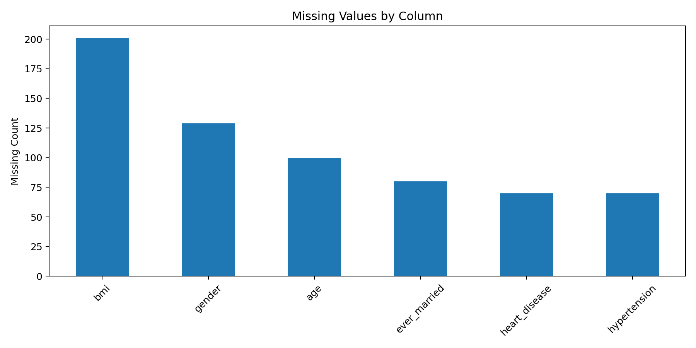
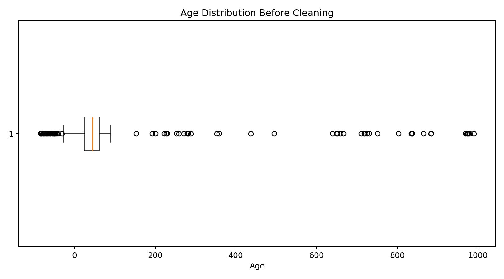
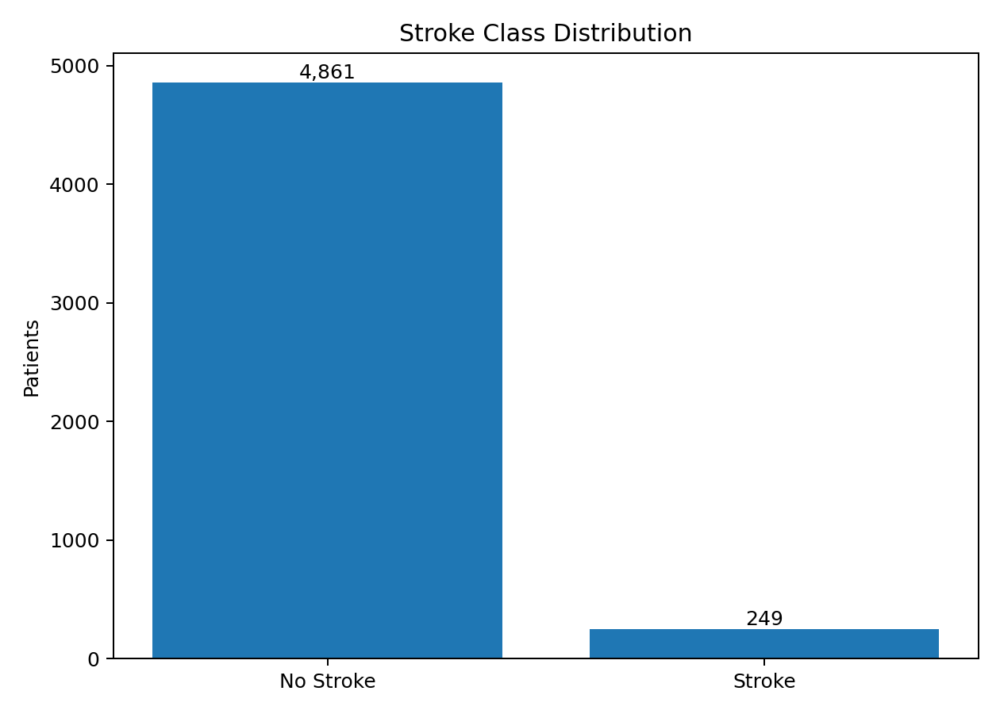
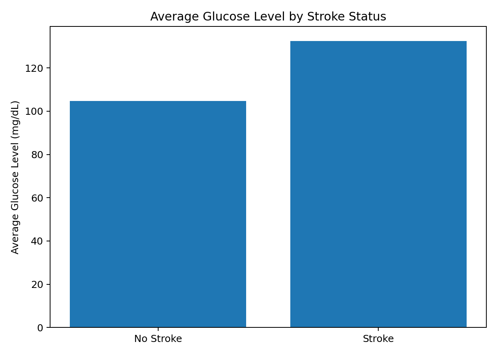
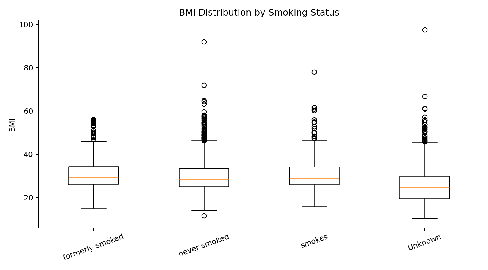
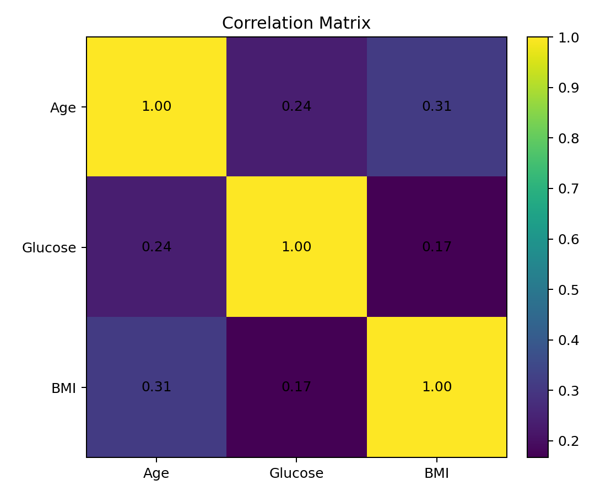

# Stroke Data Cleaning, Preprocessing and EDA

A Data Science project in **R** that cleans a messy Stroke Prediction dataset, prepares it for analysis
and explores it with statistics and charts.

Introduction to Data Science mid-term project, AIUB (Summer 2025-26, Section K, Group 04).

## Features

- Inspect the dataset: structure, summary and data types.
- Find missing values, duplicates, inconsistent categories and invalid values.
- Detect and fix age outliers.
- Fill missing values with the median (numbers) and the mode (categories).
- Convert columns to the right types (factors).
- Min-Max normalization of numeric columns.
- Filter a high-risk group (age 50+ with hypertension).
- Descriptive statistics, group comparison and correlation analysis.
- Charts and the cleaned dataset saved as CSV.

## Technologies Used

- R and RStudio
- readr (read / write CSV)
- dplyr (data cleaning)
- Base R statistics and charts

## Project Structure

```
DataScience-Stroke-Data-Cleaning-Preprocessing-EDA/
├── Code/
│   ├── Stroke_Data_Cleaning_Preprocessing_EDA.R      # cleaning, preprocessing and EDA
│   └── Stroke_Data_Cleaning_Preprocessing_EDA.Rproj  # open this in RStudio
├── DataSet/
│   ├── Stroke_Dataset_Dirty.csv                      # input data with problems
│   └── Stroke_Dataset_Clean.csv                      # cleaned output
├── Outputs/
│   ├── Figures/                                      # charts
│   └── Tables/                                       # summary tables (CSV)
└── Documentation/
    └── Stroke_Data_Cleaning_EDA_Report.pdf           # project report
```

## Requirements

- **R** – download from [cran.r-project.org](https://cran.r-project.org/)
- **RStudio Desktop** – download from [posit.co](https://posit.co/download/rstudio-desktop/)

## Clone the Project

```bash
git clone https://github.com/munshi-rishad/DataScience-Stroke-Data-Cleaning-Preprocessing-EDA.git
```

## Setup and Run

1. Install **R** and then **RStudio**.
2. Open RStudio and install the packages once (paste in the Console and press Enter):

   ```r
   install.packages(c("readr", "dplyr"))
   ```

3. Open `Code/Stroke_Data_Cleaning_Preprocessing_EDA.Rproj` (double-click it). This sets the right working folder.
4. Open `Stroke_Data_Cleaning_Preprocessing_EDA.R` from the Files panel and click **Source** (or press `Ctrl + Shift + S`).
5. The steps are printed in the Console, charts appear in the Plots panel and the cleaned data is saved as `DataSet/Stroke_Dataset_Clean.csv`.

## Dataset

5,110 patient records with 12 columns: ID, gender, age, hypertension, heart disease, ever married,
work type, residence type, average glucose level, BMI, smoking status and stroke (0 / 1).
The dirty version has missing values, inconsistent categories, invalid binary values and age outliers on purpose.

## Project Report

[Stroke_Data_Cleaning_EDA_Report.pdf](Documentation/Stroke_Data_Cleaning_EDA_Report.pdf)

## Screenshots

### 1. Missing Values

Number of missing values in each column before cleaning.

<p align="center">
  
</p>

### 2. Age Outliers

Boxplot of age showing the outliers before cleaning.

<p align="center">
  
</p>

### 3. Stroke Class Distribution

Patients with and without stroke.

<p align="center">
  
</p>

### 4. Glucose by Stroke Status

Average glucose level of stroke and non-stroke patients.

<p align="center">
  
</p>

### 5. BMI by Smoking Status

BMI spread for each smoking group.

<p align="center">
  
</p>

### 6. Correlation Matrix

Correlation between the numeric columns.

<p align="center">
  
</p>
